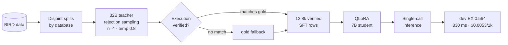

# 🐦 Heron

### Cost-Efficient Text-to-SQL via Teacher–Student Distillation

**A single-call 7B SQL model distilled from a 32B teacher — 6.3 pp behind the teacher at ~16× lower latency and ~7× lower cost.**

&nbsp;
&nbsp;
&nbsp;
&nbsp;
&nbsp;

A single-call 7B text-to-SQL model, distilled from a 32B teacher on the
[BIRD](https://bird-bench.github.io/) benchmark. The goal is **accuracy per token
and per dollar at one model call**, not leaderboard rank — a model you could
actually put in front of a warehouse.

The differentiated contribution is the **methodology and the findings**: a
disjoint-database validation discipline, a shipped-data-corruption discovery, a
mechanical failure taxonomy, and an honestly-reported distillation result with its
cost tradeoff measured — not the headline accuracy.

## Pipeline

## Results — BIRD dev (1,534 questions, execution accuracy)

| metric | 32B teacher | **7B tuned** | 7B advantage |
|---|---|---|---|
| execution accuracy | 0.627 | **0.564** | −6.3 pp |
| calls / question | 1 | **1** | — |
| p50 latency | 13,730 ms | **830 ms** | **16.5× faster** |
| cost / 1k queries | $0.0369 | **$0.0053** | **7.0× cheaper** |

*(A100 40GB @ $1.10/GPU-hr, 2026-08-03. 7B base, untuned, scores 0.537.)*

**The tuned 7B trades 6.3 pp of accuracy for ~16× lower interactive latency and
~7× lower cost — at a single call each.** Tuning is statistically significant
(+41 questions over base, McNemar χ²=8.8), driven by the student distilling the
teacher's *schema-faithfulness*: hard errors more than halved (121 → 58) as it
learned to stop hallucinating columns and join paths.

The mechanical identifier-repair guard is scored as **its own row** (guarded vs
unguarded) so it can't be folded into the headline — it recovers +2 questions on
the tuned 7B and +0 on the base, a real but marginal effect, not the story.

Full numbers and provenance: [stats.md](stats.md).

## Key findings

- **A packaging bug the benchmark ships with.** One BIRD database (`retail_world`)
  is Microsoft Northwind gold queries run against a *reduced, renamed* `.sqlite` —
  three tables missing, columns renamed. **88% of its questions are unanswerable
  by construction.** This is a *packaging* error (the DB file doesn't match its
  own golds), distinct from the annotation-error class in the literature, and it's
  mechanically detectable — see `audit_gold.py`. Found by a method, not luck: gold
  and prediction failures **co-occurred 197 times vs 46 expected under
  independence (4.3×)**, which localized the corruption to a single database.
- **Schema-format richness doesn't help a strong model.** Four prompt formats
  (bare DDL, +foreign keys, +sample values, both) are **statistically tied** on the
  32B — of 887 questions only **63 (7.1%) are format-sensitive at all** (62.7%
  every format gets right, 30.2% none do), and no arm's McNemar vs `ddl` reaches
  significance. `ddl` wins on accuracy-per-token because BIRD's DDL already embeds
  foreign keys inline, so extra context is redundant cost.
- **The single-call constraint is the whole cost story.** No agentic loop, no
  multi-call repair — which is what keeps latency and cost flat and comparable.

## Method

- **Disjoint-database splits.** Train is split into `train-fit` / `train-val` *by
  database*, so validation measures reading an *unseen* schema cold — the
  capability that transfers to dev — rather than memorized schema facts.
- **Execution-verified rejection sampling.** The 32B teacher generates 4 candidates
  per question (temp 0.8); only completions whose *result set* matches gold survive
  (12,769 verified rows). Training on verified survivors avoids BIRD's noisy gold.
- **Cardinality-gated value profiler (built for the schema-format comparison).** So
  the `samples` variants were a fair test rather than a strawman, sample values are
  listed only for low-cardinality (enum) columns under a per-prompt budget — *rules*
  frozen on train, *values* computed per-database (the leakage boundary is a module
  boundary, `derive_profile_rules.py` → `utils.py`). The shipped model uses `ddl`,
  which carries no sample values, so this is infrastructure for the arms comparison,
  not part of the final pipeline.
- **QLoRA.** 4-bit NF4 base + LoRA adapters on Qwen2.5-Coder-7B, completion-only
  loss, chat-template parity with serving.

## Dataset

[BIRD](https://bird-bench.github.io/). The data lives outside the repo at
`../Data/` (`train/` and `dev/`). Each example carries a `db_id`, a
natural-language `question`, an external-knowledge `evidence` string, and a gold
`SQL`; per-database schemas are in `{split}_tables.json` and the SQLite files in
`{split}_databases/`.

| split | questions | databases | role |
|---|---|---|---|
| train (BIRD) | 9,428 | 69 | source pool |
| &nbsp;&nbsp;↳ train-fit | 7,189 | 58 | teacher generation → SFT |
| &nbsp;&nbsp;↳ train-val | 1,835 | 10 | validation (disjoint from fit; arms run on an 887-question subsample) |
| dev (BIRD) | 1,534 | 11 | final eval (disjoint from train) |

Databases are **disjoint across every split**, so each measures reading an unseen
schema cold. `retail_world` (corrupted) and 31 flaky golds are excluded — see the
corruption finding above.

## Repository

**Pipeline (local — has the databases):**

| file | role |
|---|---|
| `utils.py` | splits, schema rendering, query execution — shared core |
| `make_splits.py` | disjoint-database train-fit / train-val splits |
| `audit_gold.py` | gold-integrity audit (found `retail_world`) |
| `derive_profile_rules.py` | train-only value-profiler rule derivation |
| `build_prompts.py` | prompt + payload builder (frozen schema variant) |
| `build_sft_data.py` | rejection-sampling → execution-verified SFT dataset |
| `score.py` | execution accuracy + full failure taxonomy |
| `analysis.py` | failure taxonomy: result-shape + AST diff |
| `sample_errors.py` | error sampling and multi-arm comparison |
| `repair.py` | mechanical identifier-repair guard |

**Compute (Colab — has the GPU):**

| file | role |
|---|---|
| `run_inference.py` | vLLM inference (greedy eval or candidate sampling) |
| `train_qlora.py` | QLoRA fine-tune + merge |
| `measure_lengths.py` | tokenizer-exact sequence lengths before training |
| `bench_latency.py` | latency + cost benchmark |

**Docs:** [RUNBOOK.md](RUNBOOK.md) — step-by-step operational guide ·
[stats.md](stats.md) — all findings and numbers.

*(`Evaluator.py` is a legacy Day-1 Gemini-API evaluator, superseded by the vLLM
pipeline above; not part of the current flow.)*

## Reproduce

The BIRD data lives outside the repo at `../Data/` (`train/` and `dev/`), from the
[BIRD download](https://bird-bench.github.io/). Then follow [RUNBOOK.md](RUNBOOK.md)
end to end — splits → taxonomy → schema arms → teacher probe → generation + SFT →
QLoRA → dev run. Local needs `pip install pandas sqlglot tqdm`; Colab install notes
are in the script headers.

## Data & artifacts

Generated artifacts are **not committed** (see `.gitignore`) — they total ~360MB.
What's what:

- **Regenerate for free:** `prompts_*` / `payload_*` are deterministic outputs of
  `build_prompts.py` (CPU). `results_*` / `errors_*` / `bench_*` re-run from
  `run_inference.py` / `score.py` / `bench_latency.py` (needs a GPU).
- **Committed on purpose:** `splits/*.json` pins the exact train/val boundary that
  everything downstream depends on (reproducing it needs the seed **and** the
  exclusion lists in `splits/manifest.json`). `profile_rules.json` is the frozen
  input to the `samples` schema arms — *not* used by the shipped `ddl` model, kept
  only so that format comparison reproduces.
- **Not reproducible → on Drive:** `candidates_train-fit_ddl.json` (teacher
  generations, temperature 0.8) and `sft_train-fit_ddl.jsonl` (the derived
  training set) cannot be recreated exactly, along with the trained LoRA adapter.

**Exact artifacts** — the non-reproducible teacher generations
(`candidates_train-fit_ddl.json`), the SFT training set
(`sft_train-fit_ddl.jsonl`), and the run outputs (`results_*`, `errors_*`,
`bench_*`): [Google Drive ↗](https://drive.google.com/drive/folders/1IxN3reqrVu649hPq1QUdHyXpULmu6btd?usp=sharing)

## Limitations

- **The headline accuracy is modest** and well below SOTA 7B (Arctic-Text2SQL-R1-7B,
  68.5% dev). This project optimizes cost-at-fixed-simplicity and methodology, not
  peak accuracy.
- **Pretraining contamination** can't be excluded for a public benchmark; the
  disjoint-database design is the mitigation, not a guarantee.
- **A specific contamination, disclosed.** The system-prompt rules were originally
  derived from *dev* error rows; they were re-derived on train-val once caught.
  Surfaced here rather than buried — it's the disclosure a careful reviewer would
  most want.
- **The student's ceiling is the teacher — and it undershot the target.** ~30% of
  the base→teacher gap was recovered (0.537 → 0.564), short of the ~70% (→ ~0.60)
  set as the success bar; the rest is bounded by the teacher's accuracy on the
  reachable subset.
- The largest remaining failure class is **schema linking** (`table_set`), not
  prompt format — the natural next direction.
